# Usage Meter

A small macOS menu bar app that shows your Claude subscription usage and tells you in plain words
whether you'll run out before the reset: the 5-hour session and weekly limits on Pro/Max, the $ budget
on Enterprise/Team seats. No browser cookie to paste: it reuses the login that
[Claude Code](https://claude.com/claude-code) already keeps on your Mac.

> **Unofficial.** Not affiliated with or endorsed by Anthropic. It relies on an
> undocumented endpoint that may change or stop working at any time.

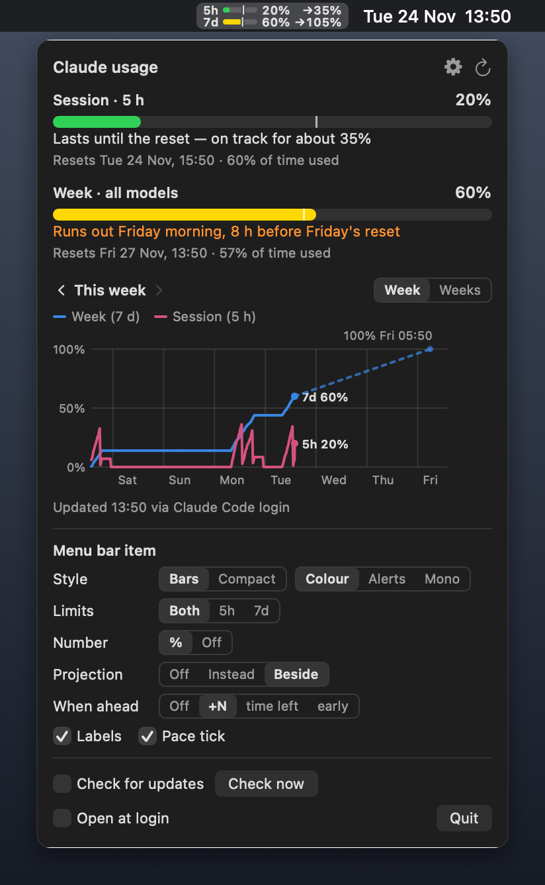

*Sample numbers and a made-up history, rendered by the app itself.*

## What it does

- **Menu bar item** with your limits at a glance: bars, rings, dots, a gauge, a sparkle or just the
  numbers, coloured by pace (green on track, yellow ahead, orange well ahead).
- **Plain-language outlook** for each limit: *Lasts until the reset — on track for about 35%*, or
  *Runs out Friday morning, 8 h before Friday's reset*.
- **Projection** in the menu bar if you like: `60% →105%` says the week runs out first.
- **History graph** of this week or budget month, with the projection to the reset. Hover for any
  point, step back through earlier periods, or look at it per day, week or month.
- **Enterprise/Team budgets** in % or dollars, and Pro/Max **extra usage** as its own item.
- **One-click updates** (opt-in), and a **command-line reader**, `claude-usage`.

Everything in detail, including all settings: the [guide](docs/GUIDE.md).

| Pro / Max | Enterprise / Team |
|---|---|
|  |  |
| 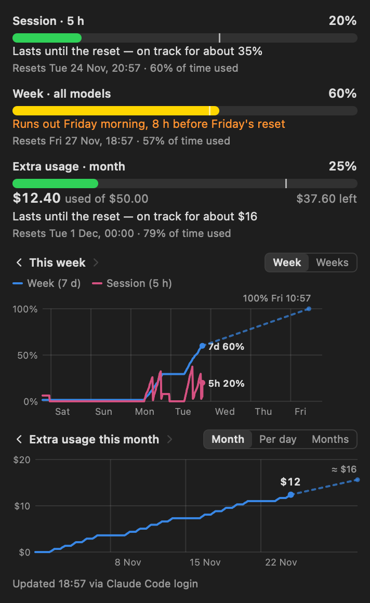 | 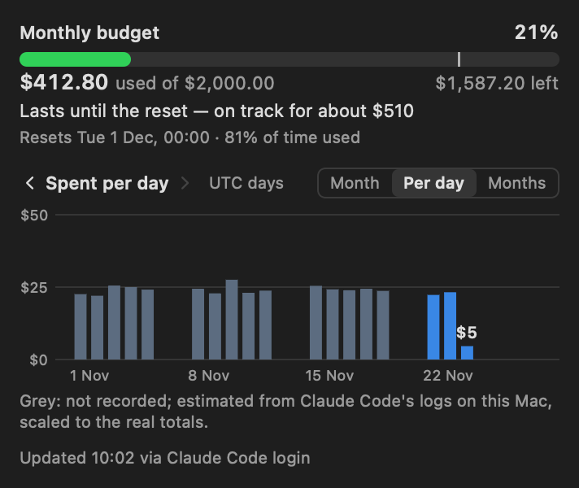 |
|  | |

### In the menu bar

At real size, on a dark and a light menu bar. Each is a setting in the popup.

| Bars | Circle | Dots |
|---|---|---|
| 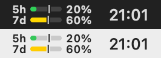 | 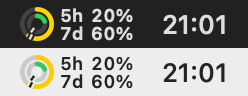 | 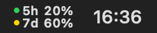 |
| **Gauge** | **Sparkle** | **Numbers only** |
| 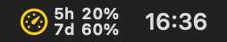 | 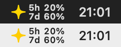 | 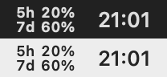 |
| **Bars, no labels** | **Circle, no labels** | **Dots, no labels** |
| 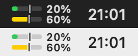 | 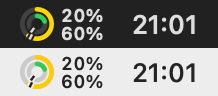 | 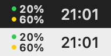 |
| **Gauge, no labels** | **Mono** | **Alerts** |
| 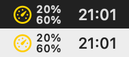 | 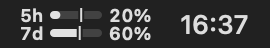 | 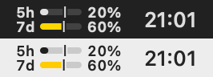 |
| **Projection** | **Projection, number off** | **Only 5h** |
| 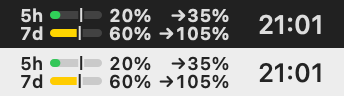 | 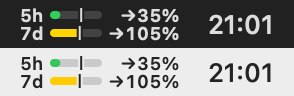 | 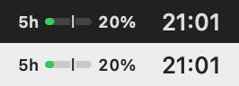 |
| **Budget** | **Budget, amount** | **Budget, projection** |
| 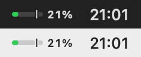 | 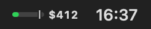 | 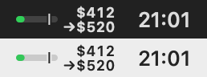 |
| **Extra usage beside the limits** |  |  |
| 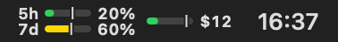 |  |  |

## Install

```bash
brew trust gtmn/tap                       # Homebrew 7 asks for this for third-party taps
brew install gtmn/tap/claude-usage-meter
brew services start claude-usage-meter    # opens it now and at every login
```

Or download the app from the [releases](https://github.com/gtmn/claude-usage-meter/releases). It isn't
notarized, so macOS asks once ([details](docs/GUIDE.md#download)). Needs macOS 14 or later and
Claude Code signed in.

## How it works

On every fetch (every 5 minutes, on wake and when you open the popup) it reads Claude Code's login from
the macOS Keychain, never storing, logging or refreshing it, and asks Claude's usage endpoint, the one
behind Claude Code's `/status`. If that fails, it falls back to what Claude Code's status line wrote.
Besides `api.anthropic.com` it talks only to GitHub, and only when you turn on update checks.
[More](docs/GUIDE.md#how-it-gets-the-data).

## Project layout

| Path | What |
|---|---|
| `UsageReader.swift` | Reads both sources, projections, plain-language wording |
| `History.swift` | Records and stores usage over time for the graph; fills gaps, daily totals |
| `ClaudeCodeLogs.swift` | Reads request times and token counts from Claude Code's logs, for the estimates |
| `LoginNudge.swift` | Runs `claude mcp list` when Claude Code's login has expired, so Claude Code renews it |
| `UpdateCheck.swift` | The opt-in update check's plain parts: versions, release files, checksums |
| `MenuBar/` | The SwiftUI menu bar app |
| `main.swift` | Command-line reader |
| `statusline-snapshot.sh` | Claude Code status-line command for the fallback |
| `tests/` | Scenario checks |
| `docs/GUIDE.md` | Everything the app shows, its settings, how it gets the data, installing |
| `docs/DEVELOPMENT.md` | Building, testing, screenshots, releasing |
| `docs/DECISIONS.md` | Why things work the way they do, and what was ruled out |
| `docs/BACKLOG.md` | What's next and open ideas |
| `docs/screenshots/` | README images, rendered from sample data |
| `.github/` | Release workflow and `package.sh`, which builds the release files |

## Development

```bash
./test.sh            # scenario checks: wording, projections, error messages
MenuBar/build.sh     # builds MenuBar/build/UsageMeter.app
MenuBar/dev.sh       # runs the checkout build in place of the Homebrew copy
```

Building, screenshots and releasing: [docs/DEVELOPMENT.md](docs/DEVELOPMENT.md). Why things are the way
they are: [docs/DECISIONS.md](docs/DECISIONS.md).

## License

MIT, see [LICENSE](LICENSE).
