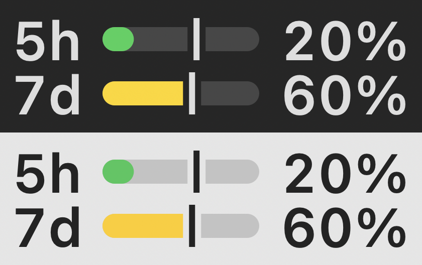
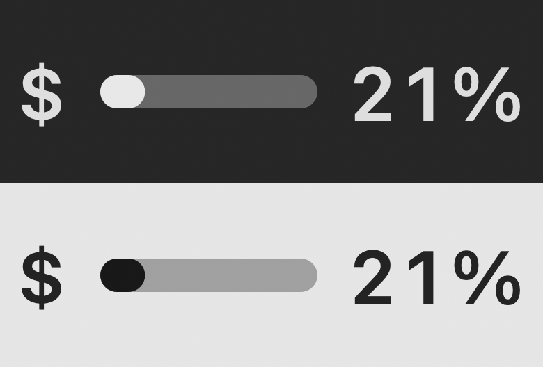
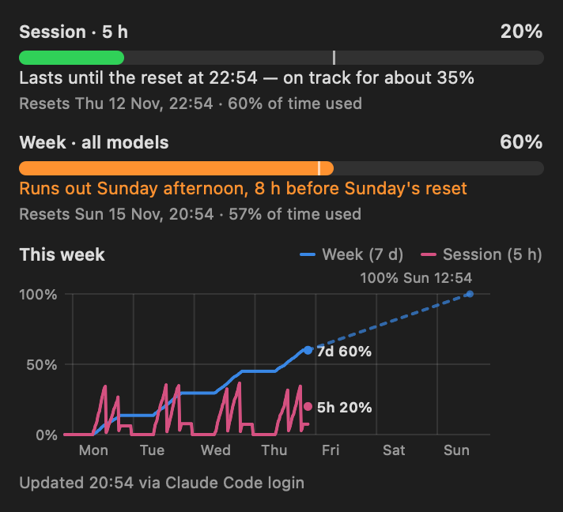
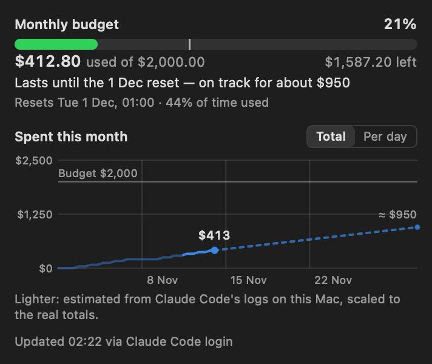
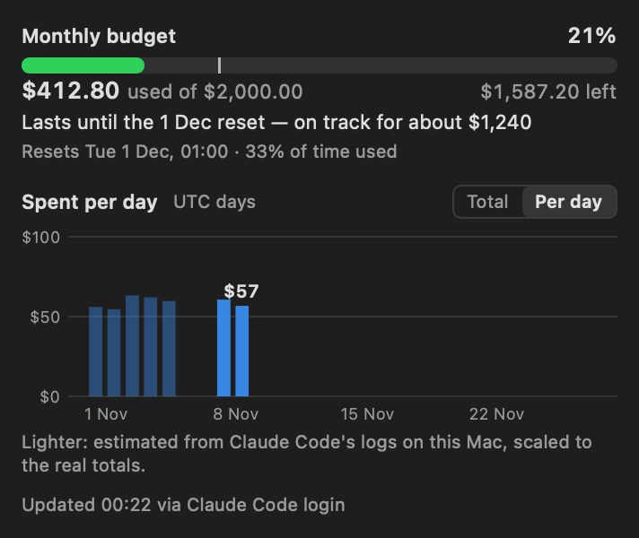

# Usage Meter

A small macOS menu bar app that shows your Claude subscription usage and tells you
in plain words whether you'll run out before the reset. It handles both kinds of plan:

- **Pro / Max:** the 5-hour session window and the weekly limit, in percent.
- **Enterprise / Team seats:** the monthly $ budget, in percent and in dollars.

| Pro / Max | Enterprise / Team |
|---|---|
|  |  |
|  |  |
| |  |

*Sample numbers and a made-up history. The menu bar item is shown enlarged, on a dark and a light menu bar.*

No browser cookie to paste. It reuses the login that [Claude Code](https://claude.com/claude-code)
already keeps on your Mac.

> **Unofficial.** Not affiliated with or endorsed by Anthropic. It relies on an
> undocumented endpoint that may change or stop working at any time.

## What it shows

- **Menu bar:** two mini bars, `5h` and `7d`, with percentages, or a single `$` bar on an
  Enterprise/Team seat. A number turns orange when that limit is nearly full (90%+) or
  projected to run out before it resets.
- **Popup**, per limit:
  - usage bar with a pace marker (how much of the window has passed)
  - for the $ budget: the amount used, the budget and what's left,
    e.g. *$412.80 used of $2,000.00 · $1,587.20 left*
  - an outlook line, e.g. *Lasts until the reset at 14:00 — on track for about 45%*,
    or in money for the budget, *Lasts until the 1 Dec reset — on track for about $1,240*
  - reset time
- **The budget's reset date** isn't part of the usage data. The app takes the real one from
  the [status-line snapshot](#optional-status-line-snapshot) when you've set that up (Claude Code
  passes it as `rate_limits.spend_limit`, along with the period: monthly, weekly or daily).
  Without it, the app assumes 00:00 UTC on the 1st of each month and marks the date *(assumed)*,
  until it sees a reset happen: the amount falling between two fetches within 20 minutes of
  00:00 UTC on the 1st confirms the date. A fall at any other time brings *(assumed)* back.
- **Pro/Max with extra usage turned on:** the same $ amounts appear as an *Extra usage*
  row below the 5h and 7d limits, and the menu bar is unchanged.
- **History graph** in the popup, a line over time like a temperature curve:
  - on an Enterprise/Team seat, money spent across the budget period, with a dashed
    projection to the reset (and the budget line once the curve gets near it). Switch to
    **Per day** for a bar per day, in UTC days like Claude's own usage page.
  - on Pro/Max, the 5h and 7d percentages this week (from the last weekly reset to the next), with a
    dashed projection of the weekly limit to 100% or to the reset, matching the outlook line
  - hover over it for the time and value at any point

  Claude's usage data only says "now", so the app records its own history from the first
  time it runs: one point per limit about every 10 minutes (and at every reset), kept for
  40 days in `~/Library/Application Support/UsageMeter/history.json`. Usage numbers only,
  never credentials.
- **Before the app ran, or while the Mac was off,** the budget curve is estimated from Claude
  Code's session logs on this Mac (`~/.claude/projects`), drawn lighter:
  - The app reads only each request's time, model and token counts, never message content,
    and keeps nothing on disk.
  - Each request is priced at list price, and the curve is scaled so it ends exactly at the
    known total. The amounts are real and only the shape in between is estimated.
  - Spending the logs can't see (the Claude apps, other computers) is spread over the
    Claude Code activity in the same stretch.
  - A stretch with no Claude Code activity stays a gap. In the per-day view, its spending
    counts on the day it was first seen, and the tooltip says so.

  Claude's own per-day chart (Settings → Usage) isn't available to the app: its endpoint
  doesn't accept Claude Code's login.
- Refreshes every 5 minutes, on wake, when the network returns, and when you open the popup.
  If a fetch fails, the last numbers stay and a short note explains why (e.g. *Offline*).

Projections are a straight-line estimate from your average rate so far in the
window. In the first 15% of a window (45 minutes of the 5-hour window, about a day
of the week, about 4½ days of the month) that rate alone is too jumpy: $20 in the
first two hours of a month would project to $7,200. So the week and the budget start
from the previous period's average pace instead, from the app's own history, e.g.
*At last month's pace: about $600 by the 1 Jan reset*. As the first 15% goes by,
this period's own spending counts more and more, and after it only this period counts.
The 5-hour session, and any limit without a recorded previous period, says
*Too early to project* until then.

## How it gets the data

1. **Claude Code login (primary).** Reads Claude Code's OAuth token from the macOS
   Keychain item `Claude Code-credentials` and calls
   `GET https://api.anthropic.com/api/oauth/usage` (the call behind Claude Code's `/status`).
   - The token is read on every fetch, never stored, logged or sent anywhere else.
   - It is **never refreshed** by this app, because that would rotate Claude Code's refresh token
     and could sign Claude Code out. Any Claude Code renews it (Terminal, IDE or the desktop app's
     Code tab), and it lasts about 8 hours. When it has expired, the app runs `claude auth status`
     once (at most every 30 minutes) if the Claude Code command is installed: it makes no model
     request and costs nothing, and it may make Claude Code renew its own login. Its output is
     discarded; the app logs only whether the login was renewed.
   - It reads the item the same way Claude Code does, through Apple's `security` tool, which the
     item already trusts. So there's no Keychain password dialog, not after a rebuild and not after
     Claude Code refreshes its token. (Asking the Keychain directly would prompt each time, because
     every rewrite of the item resets its list of allowed apps.) This doesn't open anything new:
     any program running as you can read the item this way, because that's how Claude Code stores it.
2. **Claude Code status line (fallback).** If the token can't be used, the app reads
   `~/.claude/usage-snapshot.json`, written by [`statusline-snapshot.sh`](statusline-snapshot.sh)
   from the documented `rate_limits` field Claude Code passes to status-line commands.
   The app also uses this file for the budget's reset date (`rate_limits.spend_limit.resets_at`),
   which the usage endpoint doesn't return; a reset that has already passed is ignored.

The app talks only to `api.anthropic.com`. No analytics, no update checks, no other servers.

## Requirements

- macOS 14 or later
- Xcode command line tools (`swiftc`)
- Claude Code, signed in with a Pro or Max subscription

## Install with Homebrew

```bash
brew install gtmn/tap/claude-usage-meter
brew services start claude-usage-meter   # opens it now and at every login
```

Homebrew builds the app from source on your Mac (about a minute), so no download
is quarantined and no notarization is needed. It also installs the command-line
reader as `claude-usage` and the status-line script under
`$(brew --prefix)/share/claude-usage-meter/`. Use `brew services` to open it at login:
a Homebrew copy hides the app's **Open at login** switch, which would remember the
versioned Homebrew folder that changes with every upgrade. Under `brew services` the
popup says *Opens at login (brew services)* instead.

## Build and run from a checkout

```bash
cd MenuBar
./build.sh            # builds MenuBar/build/UsageMeter.app (ad-hoc signed, this Mac only)
./build.sh --install  # also copies it to ~/Applications and launches it
```

Enable **Open at login** in the popup after installing.

### Optional: status-line snapshot

Recommended on Enterprise/Team seats, where it supplies the budget's real reset date.
Copy the script and point Claude Code's status line at it in `~/.claude/settings.json`:

```bash
cp statusline-snapshot.sh ~/.claude/
```

```json
"statusLine": { "type": "command", "command": "~/.claude/statusline-snapshot.sh" }
```

Already using a status line? Keep it by setting `NEXT_STATUSLINE` to its command;
the script passes the same input on to it.

## Command-line reader

Installed as `claude-usage` by Homebrew; from a checkout:

```bash
swiftc -O -o usage UsageReader.swift main.swift
./usage            # Claude Code login, falling back to the status-line file
./usage oauth      # Claude Code login only
./usage snapshot   # status-line file only
./usage raw        # raw JSON from the usage endpoint
```

## Tests

```bash
./test.sh
```

Prints the outlook wording for fixed scenarios (in UTC, so the output is the same
on any machine) and the short message for each kind of error.

## Screenshots

The images in [`docs/screenshots/`](docs/screenshots) are rendered from sample numbers
(no Keychain access, no real usage), so they can be regenerated at any time:

```bash
cd MenuBar && ./build.sh && cd ..
APP=MenuBar/build/UsageMeter.app/Contents/MacOS/UsageMeter
$APP --render-preview docs/screenshots/popup-pro-max.png
$APP --render-preview docs/screenshots/popup-enterprise.png enterprise
$APP --render-preview docs/screenshots/popup-enterprise-daily.png enterprise daily
mv docs/screenshots/popup-pro-max.png.label.png docs/screenshots/menubar-pro-max.png
mv docs/screenshots/popup-enterprise.png.label.png docs/screenshots/menubar-enterprise.png
```

Add `daily` for the per-day bars, `hover` to show the graph's tooltip, `light` for light mode, or `live` to render your
own current numbers and recorded history instead (don't commit those).

## Layout

| Path | What |
|---|---|
| `UsageReader.swift` | Reads both sources, projections, plain-language wording |
| `History.swift` | Records and stores usage over time for the graph; fills gaps, daily totals |
| `ClaudeCodeLogs.swift` | Reads request times and token counts from Claude Code's logs, for the estimates |
| `LoginNudge.swift` | Runs `claude auth status` when Claude Code's login has expired |
| `MenuBar/` | The SwiftUI menu bar app |
| `main.swift` | Command-line reader |
| `statusline-snapshot.sh` | Claude Code status-line command for the fallback |
| `tests/` | Scenario checks |
| `docs/screenshots/` | README images, rendered from sample data |

## License

MIT, see [LICENSE](LICENSE).
