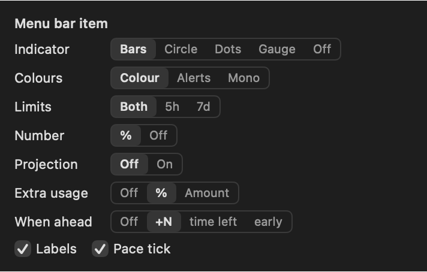
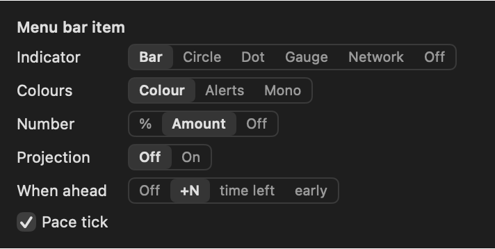

# Usage Meter guide

Everything the [README](../README.md) leaves out: what each part of the popup and the menu bar shows,
the settings, how the app gets its data, installing, and the command-line reader.

## What it shows

- **Menu bar**, with one of these indicators, switched under **Indicator** in the popup's settings (the gear button):
  - **Bars** (default): two mini bars, `5h` and `7d`, with percentages (or just one of them,
    see [Settings](#settings)), or a single `$` bar on an Enterprise/Team seat.
  - **Circle**: rings with their percentages beside them: the week outside and the 5h
    session inside (the week follows the weekly limit furthest ahead of pace), or one budget
    ring on an Enterprise/Team seat.
  - **Dots**: no bars, just the numbers, each after a small dot in its pace colour.
  - **Gauge**: a gauge before the numbers, in the colour of the limit furthest ahead of pace, its
    needle at the highest use.
  - **Off**: just the numbers, no graphic and no colour.

  All but Off use the same colours, as ClaudeUsageBar's pace icon: green on or under pace, yellow
  ahead of it, orange 15+ points ahead (about a day early in a week) or nearly full (90%+). Early
  in a window, where a few percent would look far ahead, it stays plain. Switch **Colour** to
  **Mono** for bars or rings in the menu bar's text colour, like the numbers, or to **Alerts** for
  the text colour while on or under pace and yellow or orange only once a limit is ahead or nearly full. On a $ budget,
  the number can be the share used (`21%`) or the money spent so far (`$306`). The popup's settings
  turn on or off the `5h`/`7d` **labels**, the **number**, a **pace tick** where usage
  would be if spread evenly over the window, and, once a limit is 15+ points ahead, the points
  ahead of pace (`+24`: % used minus % expected by now), the time left until it runs out
  at that pace (`1.5d left`), or how long before the reset that is (`3d early`). Times are rounded: half days from a day on (`1.5d`),
  whole hours below, and minutes under an hour for the 5h session only.
- **Popup**, per limit:
  - usage bar with a pace marker (how much of the window has passed)
  - for the $ budget: the amount used, the budget and what's left,
    e.g. *$412.80 used of $2,000.00 · $1,587.20 left*
  - an outlook line, e.g. *Lasts until the reset — on track for about 45%*,
    or in money for the budget, *Lasts until the reset — on track for about $1,240*
  - reset time
- **The budget's reset date** isn't part of the usage data. The app takes the real one from
  the [status-line snapshot](#optional-status-line-snapshot) when you've set that up (Claude Code
  passes it as `rate_limits.spend_limit`, along with the period: monthly, weekly or daily).
  Without it, the app assumes 00:00 UTC on the 1st of each month and marks the date *(assumed)*,
  until it sees a reset happen: the amount falling between two fetches within 20 minutes of
  00:00 UTC on the 1st confirms the date. A fall at any other time brings *(assumed)* back.
- **Pro/Max with extra usage turned on:** the same $ amounts appear as an *Extra usage*
  row below the 5h and 7d limits, with its own graph under the 5h/7d one (recorded only:
  Claude Code's logs can't tell which activity was paid extra). Tick **Extra usage beside it**
  to add a `$` item next to the 5h/7d one in the menu bar, as `%` or the amount.
- **History graph** in the popup, a line over time like a temperature curve:
  - on an Enterprise/Team seat, money spent across the budget period, with a dashed
    projection to the reset (and the budget line once the curve gets near it): **Month** (or
    **Week** for a weekly budget). Switch to **Per day** for a bar per day, in UTC days like
    Claude's own usage page, or **Months** for the totals of recent months.
  - on Pro/Max, the 5h and 7d percentages this week (from the last weekly reset to the next), plus a
    line for a model's own weekly limit (Fable) when the plan has one, with a
    dashed projection of the weekly limit to 100% or to the reset, matching the outlook line
  - hover over it for the time and value at any point
  - **‹ ›** step back through earlier weeks (or budget months) as far as the history goes; click
    the title to return to now. Past periods show how they went, without a projection.
  - **Weeks** (or **Months**) switches to the long view: the weekly % (or the money spent) as one
    line over several periods, a dashed line at each reset with its date, and what each period
    reached labelled just before its reset (an orange point where it ran out or reached the
    budget). Hover for the time, the value, the period's dates and when it ran out. Eight weeks
    (six months) at a time; ‹ › page through older ones.
  - **5h limit hits** (Pro/Max): each time the 5h session reached 100% is an orange point on the
    session line in the week view, and an orange tick along the bottom of the long view, where
    each week's label counts them (`5h ×3`). Hover for when it was hit and how long it was blocked
    until the session reset ("at least" when the Mac was asleep around the reset).

  Claude's usage data only says "now", so the app records its own history from the first
  time it runs: one point per limit about every 10 minutes (and at every reset), in
  `~/Library/Application Support/UsageMeter/history.json`. Usage numbers only, never
  credentials. It's kept without a time limit; after 60 days it's thinned to one point per
  limit per hour (the highest, so each period's peak before its reset stays), about 2 MB a year.
- **Before the app ran, or while the Mac was off,** the budget curve is estimated from Claude
  Code's session logs on this Mac (`~/.claude/projects`), drawn in grey:
  - The app reads only each request's time, model and token counts, never message content,
    and keeps nothing on disk.
  - Each request is priced at list price, and the curve is scaled so it ends exactly at the
    known total. The amounts are real and only the shape in between is estimated.
  - Everything the app didn't record is drawn in grey, quiet time included: the logs can't
    see spending elsewhere. The hover says "(estimated)" where spending was placed and
    "about $… · no activity" where the logs show none (a weekend, a night). An unrecorded
    stretch with the same amount on both sides stays solid, since nothing was spent in it.
  - Spending the logs can't see (the Claude apps, other computers) is spread over the
    Claude Code activity in the same stretch.
  - A stretch with no Claude Code activity stays a gap. In the per-day view, its spending
    counts on the day it was first seen, and the tooltip says so.

  Claude's own per-day chart (Settings → Usage) isn't available to the app: its endpoint
  doesn't accept Claude Code's login.
- Refreshes every 5 minutes, on wake, when the network returns, and when you open the popup.
  If a fetch fails, the last numbers stay and a short note explains why (e.g. *Offline*).
  That works across restarts too: the app keeps the last good numbers in
  `~/Library/Application Support/UsageMeter/last-usage.json` (limits, numbers and reset times
  only) and shows them at launch until a fetch succeeds, leaving out any limit that has reset since.
  While it shows saved numbers, the popup says so at the top, e.g. *Saved numbers from 01:57 ·
  Too many requests, will retry*.

Projections are a straight-line estimate from your average rate so far in the
window. In the first 15% of a window (45 minutes of the 5-hour window, about a day
of the week, about 4½ days of the month) that rate alone is too jumpy: $20 in the
first two hours of a month would project to $7,200. So the week and the budget start
from the previous period's average pace instead, from the app's own history, e.g.
*At last month's pace: about $600 by the reset*. A period counts once the app
recorded at least a quarter of it; if the last one has less (the Mac was off), the most
recent earlier one the history covers stands in (*At an earlier week's pace: …*). As the
first 15% goes by, this period's own spending counts more and more, and after it only this
period counts. The 5-hour session, and any limit without such a period, says
*Too early to project* until then, unless more than 15% is already used: that's ahead of
an even pace for the whole first 15%, so it projects as if that usage had taken all of it
(the slowest it can be going) and the colours and alerts apply, e.g. 58% twenty minutes
into a session: *Runs out around 10:52*.

## Settings

The gear button at the top of the popup shows or hides the settings (open on first start;
the app remembers when you close them). They sit under the graph: **Menu bar item**, one setting per row, then
**Open at login**, **Check for updates** and **Quit** (⌘Q also quits while the popup is open).
Hover over a control to see what it does.

- **Indicator**: Bars, Circle, Dots, Gauge or Off (on a $ budget: Bar and Dot). With Dots or Off the
  item needs a number or the projection, so the choices that would leave it empty are greyed out.
- **Colours** (not with Off): Colour, Alerts or Mono. In Dots, Mono has no dots and Alerts shows one only once ahead.
- **Limits** (Pro/Max): both, or only `5h` or `7d`. The popup and the graph keep showing both.
  An account without a 5-hour limit shows only `7d` anyway.
- **Number**: `%` or off; on a $ budget also the amount spent.
- **Projection**: off or on: where each limit is heading at its reset (`→35%`, `→140%` when it runs
  out first), after the number, or on a second line beside a single bar or ring. With **Number** off
  it takes the number's place, and the number shows until there's a projection (early in a window, or at 100%).
- **Extra usage** (Pro/Max with extra usage turned on): a `$` item beside the limits, as `%` or amount.
- **When ahead**: off, or how far ahead once a limit is 15+ points ahead of pace.
- **Labels** and **Pace tick** (only for Bars and Circle, which have a bar or ring to put it on). On a $ budget there's no Labels setting and no `$` label: one bar
  needs no label, and the amount (`$306`) has its own `$`.

| Pro / Max | Enterprise / Team |
|---|---|
|  |  |

**Updates.** With **Check for updates** on, a newer version shows under the popup's title, with
what's new and an **Update** button that installs it the way your copy came. A Homebrew copy
asks the tap's formula, so it only hears about a version `brew upgrade` can already install; a
downloaded copy asks for the latest GitHub release.
- Homebrew: `brew update` and `brew upgrade claude-usage-meter` (it builds from source, about a
  minute), then restarts through `brew services`, or opens the new copy. Updating from 0.1.13
  needs one manual step: that version's restart doesn't work, so run
  `brew services restart claude-usage-meter` after it says it's restarting.
- Download: fetches the release zip, checks it against the release's `SHA256SUMS.txt`, replaces the
  app and reopens it. A file the app downloads itself isn't quarantined, so there's no warning.

The app asks at most once a day, also across restarts and sleep. **Check now** asks once, right away, also
with the setting off, and says "Up to date" or which
version is out. A dev build hears about releases but doesn't install them. `UsageMeter --check-update`
asks once from the command line.

## How it gets the data

1. **Claude Code login (primary).** Reads Claude Code's OAuth token from the macOS
   Keychain item `Claude Code-credentials` and calls
   `GET https://api.anthropic.com/api/oauth/usage` (the call behind Claude Code's `/status`).
   - The token is read on every fetch, never stored, logged or sent anywhere else.
   - It is **never refreshed** by this app, because that would rotate Claude Code's refresh token
     and could sign Claude Code out. Claude Code in Terminal or an IDE renews it (the desktop app's
     Code tab doesn't seem to), and it lasts about 8 hours. When it has expired, the app runs `claude mcp list`
     once (at most every 30 minutes, in an empty folder) if the Claude Code command is installed.
     Checking the MCP connections makes Claude Code renew its own login; it sends no request to a
     model and costs nothing. (`claude auth status` only reports the expiry.) The command's output
     is discarded; the app logs only whether the login was renewed, in `~/Library/Logs/UsageMeter.log`.
   - If that doesn't bring the login back (Claude Code's longer-lived refresh token has run out too),
     the popup says *Signed out of Claude Code* with a **Sign in…** button and the menu bar item fades.
     The button opens Terminal running `claude auth login`, Claude Code's own sign-in; the app doesn't
     see it, and fetches again as soon as the new login is in the Keychain.
   - It reads the item the same way Claude Code does, through Apple's `security` tool, which the
     item already trusts. So there's no Keychain password dialog, not after a rebuild and not after
     Claude Code refreshes its token. (Asking the Keychain directly would prompt each time, because
     every rewrite of the item resets its list of allowed apps.) This doesn't open anything new:
     any program running as you can read the item this way, because that's how Claude Code stores it.
2. **Claude Code status line (fallback).** If the token can't be used, the app reads
   `~/.claude/usage-snapshot.json`, written by [`statusline-snapshot.sh`](../statusline-snapshot.sh)
   from the documented `rate_limits` field Claude Code passes to status-line commands.
   The app also uses this file for the budget's reset date (`rate_limits.spend_limit.resets_at`),
   which the usage endpoint doesn't return; a reset that has already passed is ignored.

The app talks only to `api.anthropic.com`, plus GitHub if you turn on **Check for updates**
(off by default; once a day) or click **Check now**: it asks for the latest version number, sending
nothing about you or your usage. No analytics, no other servers.

## Requirements

- macOS 14 or later
- Xcode command line tools (`swiftc`), except for the download
- Claude Code, signed in with a Pro or Max subscription or an Enterprise/Team seat

## Install with Homebrew

```bash
brew trust gtmn/tap                       # Homebrew 7 asks for this for third-party taps
brew install gtmn/tap/claude-usage-meter
brew services start claude-usage-meter    # opens it now and at every login
```

Homebrew builds the app from source on your Mac (about a minute), so no download
is quarantined and no notarization is needed. It also installs the command-line
reader as `claude-usage` and the status-line script under
`$(brew --prefix)/share/claude-usage-meter/`. Use `brew services` to open it at login:
a Homebrew copy hides the app's **Open at login** switch, which would remember the
versioned Homebrew folder that changes with every upgrade. Under `brew services` the
popup says *Opens at login (brew)* instead.

To update: `brew upgrade claude-usage-meter`. If a new version doesn't show up, run
`brew update` first: Homebrew refreshes its taps by itself at most once a day.

## Download

Each version tag gets a [release](https://github.com/gtmn/claude-usage-meter/releases) with a
pre-built app for Apple silicon and Intel Macs (`UsageMeter-<version>.zip`) and the command-line
reader (`claude-usage-<version>.zip`). They're built by GitHub Actions
([`.github/workflows/release.yml`](../.github/workflows/release.yml)).

The app is ad-hoc signed but not notarized, so macOS blocks it the first time: open it once,
then click **Open Anyway** in System Settings → Privacy & Security. Or remove the quarantine:

```bash
xattr -dr com.apple.quarantine /Applications/UsageMeter.app
```

Homebrew is still the easier way: no warning, and `brew upgrade` updates it. Turn on
**Open at login** in the popup's settings to start it at login.

## Optional: status-line snapshot

Recommended on Enterprise/Team seats, where it supplies the budget's real reset date.
Copy the script and point Claude Code's status line at it in `~/.claude/settings.json`:

```bash
cp statusline-snapshot.sh ~/.claude/   # from a checkout; Homebrew puts it in $(brew --prefix)/share/claude-usage-meter/
```

```json
"statusLine": { "type": "command", "command": "~/.claude/statusline-snapshot.sh" }
```

Already using a status line? Keep it by setting `NEXT_STATUSLINE` to its command;
the script passes the same input on to it.

## Command-line reader

Installed as `claude-usage` by Homebrew; from a checkout:

```bash
swiftc -O -o usage UsageReader.swift main.swift
./usage            # Claude Code login, falling back to the status-line file
./usage oauth      # Claude Code login only
./usage snapshot   # status-line file only
./usage raw        # raw JSON from the usage endpoint
```
